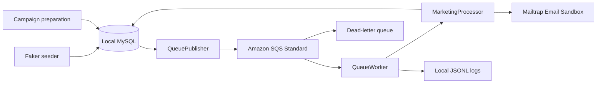
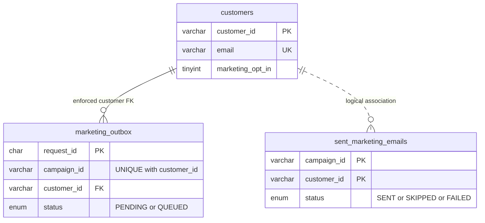

# Hybrid Promotional Campaign Laboratory

Local PHP 8.2 OOP + MySQL 8 + Faker + Amazon SQS Standard queues + Mailtrap Email Sandbox.

## Current verified state

Local implementation and live baseline verified. Ten automated tests pass with SQS/SMTP mocked at the external boundaries. Real MySQL 8.4.13 schema checks pass. The population is 10,000 customers (8,000 opted in, 2,000 opted out), with 50 stable, distinct eligible recipients for CAMP-001 / PROMO15. The completed baseline has **50 SENT, zero SKIPPED, zero FAILED**, with 50 complete publication/processing/deletion traces and an empty queue. A live sequential duplicate was skipped and acknowledged without another email.

AWS/IAM/dashboard/alarm/SNS setup is verified. The operator reports completing the disconnected demonstration and screenshots. The controlled malformed request failed three times and reached the DLQ. A corrected recovery request for an opted-out customer was recorded SKIPPED and acknowledged without SMTP; the original DLQ message was then removed and the DLQ verified empty. The operator reports capturing alarm transitions. **The Google Docs report has been assembled with captioned evidence and a reviewed reflection; final submission is performed by the student.** The live baseline evidence is distinct from the automated tests' simulated sends. Private evidence files and working notes stay out of this repository.

## Architecture



Only customer IDs and campaign content go to SQS. The processor resolves names, addresses, and current consent locally. Mailtrap captures fictional example.com recipient messages. Use one preparation process and one worker at a time.

## Install and configure

Requirements: PHP 8.2+ with pdo_mysql, openssl, mbstring; Composer; MySQL 8.0.16+ or instructor-approved compatible server; AWS CLI; approved AWS credentials; Mailtrap sandbox with 50 submissions remaining.

```powershell
composer install
composer dump-autoload
php --version
php -r "var_export(PDO::getAvailableDrivers());"
```

Create marketing_lab locally with utf8mb4, then set DB_HOST, DB_PORT, DB_NAME, DB_USER, DB_PASSWORD in the terminal. See .env.example for variable names; it is a reference, not an automatically loaded dotenv file.

This activity computer uses a separate portable MySQL 8.4.13 instance at 127.0.0.1:3308, because the existing XAMPP server reported Aria permission-table corruption. `tools/start-mysql.ps1` starts the portable server if it is stopped. Runtime files and data are ignored under .local; they are not distributed with the repository. Do not start a second copy while it is already running. Local admin and application passwords were randomly generated and remain private.

`config.php` optionally reads .local/environment.json into environment variables that are not already set. `tools/configure.ps1` prompts for nonsecret settings and hidden Mailtrap credentials, saving only to this ignored local file. Standard environment configuration also works without this file. Keep real credentials out of source and screenshots.

For AWS, configure a separate restricted profile:

```powershell
aws configure --profile marketing-lab
$env:AWS_PROFILE = 'marketing-lab'
$env:AWS_REGION = 'ap-southeast-2'
$env:SQS_QUEUE_URL = 'YOUR_MAIN_QUEUE_URL'
aws sts get-caller-identity
```

On this computer, `tools/aws.ps1` wraps the privately installed AWS CLI if `aws` is not on PATH. The old payroll-lab profile identifies a different deployer and must not be assumed to be the restricted application user.

## Local preparation (can run offline after installation)

```powershell
php init-db.php
php seed-customers.php
php inspect.php
php prepare-campaign.php CAMP-001 PROMO15
php prepare-campaign.php CAMP-001 PROMO15
php tools/capture-local.php
```

Expected: 10,000 customers, exact 8,000/2,000 consent split, 50 PENDING requests, zero ineligible recipients, unchanged selection on repeat, no history before processing. Existing customers are not overwritten. Partial selections fail rather than choosing replacement winners. Repeat this demonstration with internet disconnected and preserve screenshots separately.

## AWS setup and baseline

Follow docs/AWS-HANDS-ON.md. Create a dedicated Standard main queue and DLQ, the limited IAM application policy, dashboard, and both alarms before enqueueing. No Lambda, API Gateway, S3, or web deployment is needed.

Use sandbox SMTP credentials and STARTTLS; keep certificate checks enabled. Default MAILTRAP_DELAY_SECONDS is 11. Only lower it if your assigned plan explicitly allows the aggregate rate. Use one worker; it receives one message per poll so throttled sends do not leave a prefetched batch expiring.

```powershell
# Worker stopped: save baseline dashboard evidence first.
php enqueue.php
php enqueue.php
php inspect.php
# Second publication should report zero.
php worker.php
# Optional bounded run: php worker.php 50
```

In another terminal:

```powershell
Get-Content .\logs\events.jsonl -Tail 20 -Wait
php inspect.php CAMP-001
```

Expected baseline: 50 SENT, correct PROMO15 in Mailtrap samples, zero unresolved failures, queue eventually empty. Save Mailtrap samples during processing; retained inbox count is not the count of accepted submissions.

## Duplicate, failure and recovery

1. After baseline completion, run `php tools/diagnostic-payload.php duplicate`; submit its JSON to the main queue. Verify duplicate_skipped + deleted, no new SMTP send.
2. Send `{"campaignId":"CAMP-BROKEN","subject":"Test","body":"Missing IDs"}` to the main queue. Observe retries, DLQ visible backlog, and alarm transition. Do not manually poll the main queue while counting retries.
3. Run `php tools/diagnostic-payload.php recovery`; submit that JSON to the main queue. CUST-08001 is opted out: expect CAMP-RECOVERY SKIPPED + deleted, no SMTP send.
4. After recovery is verified, remove only the original malformed DLQ message. Capture backlog zero and alarm OK. Record the incident separately from CAMP-001.

## Tests

```powershell
composer test
composer test:mysql
```

`test:mysql` uses marketing_lab_test, clears only its fixture tables, and refuses the production database name. It requires an account granted access to that dedicated test database. The main suite uses SQLite for local persistence and real PHPMailer message construction, with only SMTP delivery and AWS operations replaced. No email quota is consumed.

On this Windows execution sandbox, PHP is_readable checks can incorrectly reject SDK data files despite readable contents. Running tests in the normal local terminal resolves this; dependencies are not patched.

## OOP / completion map

| Class | Responsibility / completed markers |
|---|---|
| Database | UTC PDO connection, native prepared statements |
| Settings | Required environment variables, SQS and SMTP settings |
| LocalDatabaseTools | Student schema initialization and inspection |
| CustomerSeeder | Faker and consent split; S1-S2 |
| CampaignPreparer | Atomic stable selection and requests; C1-C3 |
| QueuePublisher | Acknowledged publication and logs; Q1-Q2, M1 |
| EmailSender | Personalized plain-text SMTP message; E1-E2 |
| EmailHistory | Latest campaign/customer outcome |
| MarketingProcessor | Validation, consent, terminal suppression, sending/storage; P1-P5, M2 |
| QueueWorker | Receive, process, acknowledge, distinguish errors; W1-W2, M3 |
| ActivityLogger | UTC JSONL events with approved, filtered metadata |

D1 is implemented in schema.sql. Entry scripts construct injected dependencies; business logic stays in these classes.

## Data model and limitations



Outbox state and processing outcome are separate. SENT means sandbox SMTP acceptance, not real inbox delivery. SENT and SKIPPED are terminal for a campaign/customer pair; FAILED is retryable. SQS Standard is at least once: SMTP acceptance followed by a failed history write can cause another send; SQS acceptance followed by a failed outbox update can cause republishing. This lab suppresses sequential duplicates and does not claim exactly-once delivery.

Never commit database dumps, generated customer records, logs, .local, real environment settings, or vendor. schema.sql contains definitions only. Keep evidence local and put selected screenshots in the report. Review staged files and run the secret scan before publishing.

## Submission

Use docs/REPORT.md for the Google Docs report content and docs/EVIDENCE.md for screenshot captions. Fill your name, student number, section, and reflection, then share both report and repository with your instructor and submit through the class channel.
